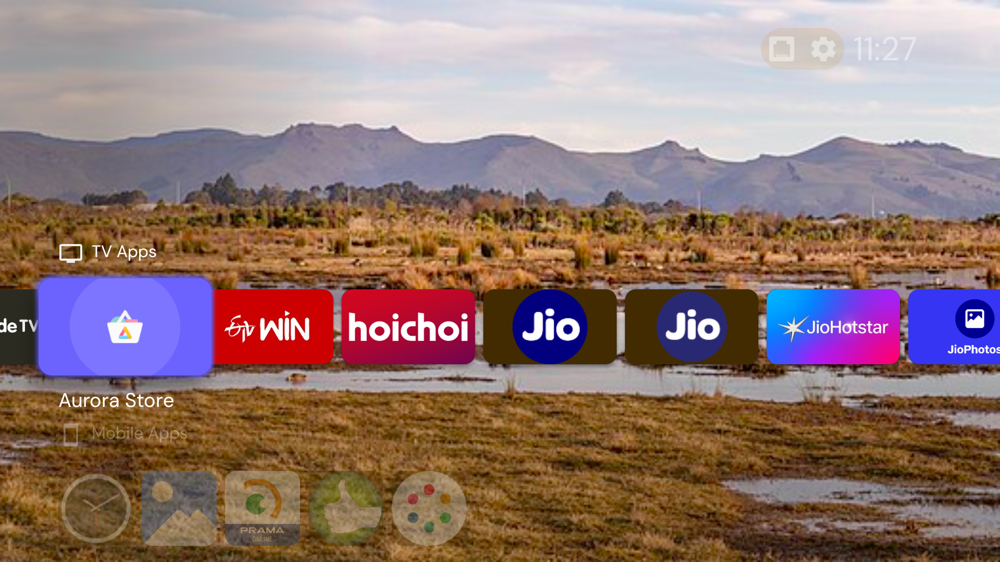
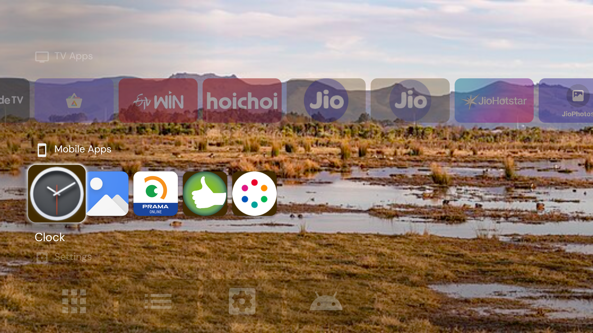
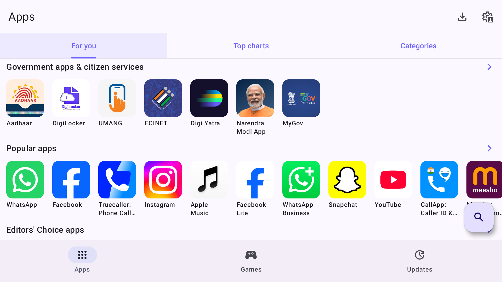

# 🚀 Jio STB Universal Unlock & Modding Hub

[](#)
[](#)
[](#)
[](LICENSE)

A comprehensive, production-grade guide and automation toolkit for unlocking, debloating, and transforming locked **Reliance Jio Set-Top Boxes (STB)** into clean, high-performance Android TV powerhouses.

<p align="center">
  
</p>

<p align="center">
  <b>✨ Transform Your Locked Jio STB into an Open Android TV Powerhouse</b><br>
  <i>Running clean Projectivy Launcher, FreeView-IPTV, Dolby Atmos, and Google Play apps via Aurora Store.</i>
</p>

---

## 📸 Visual Showcase

<table align="center" width="100%">
  <tr>
    <td align="center" width="50%">
      <b>📺 Custom Apps & Sideloaded Tools</b><br><br>
      
    </td>
    <td align="center" width="50%">
      <b>🛒 Aurora Store (Direct Google Play Access)</b><br><br>
      
    </td>
  </tr>
</table>

---

## 📑 Supported Hardware & Compatibility Matrix

| STB Model | SoC / Chipset | Android Version | ADB Unlock Method | Custom Launcher | Status |
| :--- | :--- | :--- | :--- | :--- | :--- |
| **JMSB200Av2** | Amlogic S905-series | **Android 11** | TR-069 / GenieACS RPC | Projectivy Launcher | 🟢 **Verified & Stable** |
| **JHSD200** | Amlogic S905X2 | Android 9 Pie | TR-069 / ADB over Wi-Fi | Leanback / Projectivy | 🟢 **Supported** |
| **JHS200** | Amlogic | Android 9 Pie | TR-069 / Fastboot | ATV Launcher | 🟢 **Supported** |
| **JMB200** | Marvell / Amlogic | Android 9 Pie | CWMP Injection | Projectivy Launcher | 🟡 **Community Tested** |
| **JHT200** | Broadcom / Amlogic | Android 9 / 10 | TR-069 / Serial UART | Custom | ⏳ **WIP** |

---

## 🌟 What This Toolkit Achieves
- 🔓 **TR-069 / CWMP ACS Exploitation:** Enable ADB debugging wirelessly on production locked firmware without hardware disassembly.
- 📡 **FreeView-IPTV:** [500+ Zero-Subscription Live Channels on Jio STB](docs/free_live_tv_500_channels.md) without JioFiber ISP locks.
- 📺 **Ad-Free Custom TV Experience:** Replace intrusive default operator launchers with lightweight, customizable **Projectivy Launcher**.
- 🛒 **True Alternative App Stores:** Direct integration with **Aurora Store** (official Google Play Store API without GMS/certification locks) and **Aptoide TV**.
- 🔊 **Cinematic Audio Unlock:** Force-enable hidden hardware decoding for **Dolby Atmos**, **DTS-HD Master Audio**, and disable dynamic range compression (DRC).
- 🧹 **Deep Debloating:** Remove 22+ background telemetry trackers, ad services, and background CPU hogs while preserving critical account services.
- ⚙️ **Hidden Android TV Settings:** Directly expose Stock Android TV Settings and Developer Options.

---

## 📂 Repository Architecture (Pro Monorepo Structure)

```text
jio-stb-unlock-hub/
├── README.md                          # Main repository landing page & matrix
├── jio_stb_adb_unlocker.html          # Interactive Web Dashboard & Control Suite (by DC)
├── Jio_STB_ADB_Unlocker.bat           # Windows 1-Click Double-Clickable Auto Script
├── Jio_STB_ADB_Unlocker.ps1           # Windows PowerShell Automation Engine
├── docs/                              # Universal technical documentation
│   ├── tr069_exploit_guide.md         # TR-069 / GenieACS setup walkthrough
│   ├── safe_debloat_guide.md          # Bloatware vs critical service index
│   └── audio_enhancements.md          # Dolby Atmos / DTS-HD activation guide
├── models/                            # Model-specific deep guides & firmware notes
│   ├── JMSB200Av2/                    # Jio STB JMSB200Av2 (Android 11)
│   │   ├── README.md                  # Complete step-by-step model guide
│   │   └── screenshots/               # High-res 1080p UI screenshots
│   ├── JHSD200/
│   │   └── README.md
│   └── JHS200/
│       └── README.md
└── scripts/                           # Reusable automation tools
    ├── monitor_and_unlock.py          # Automated TR-069 ACS RPC listener & unlocker
    ├── debloat.sh                     # One-click safe debloating script
    └── setup_stb.sh                   # Automated launcher & settings provisioner
```

---

## ⚡ Quick Start: Unlocking Your Device

### Option A: Interactive Web Dashboard / Windows Script (Developed by DC)
- **Web Dashboard:** Open [`jio_stb_adb_unlocker.html`](jio_stb_adb_unlocker.html) in any web browser for interactive controls, live logs, and one-click RPC execution.
- **Windows Users:** Simply double-click [`Jio_STB_ADB_Unlocker.bat`](Jio_STB_ADB_Unlocker.bat) to automatically monitor GenieACS, push unlock parameters, and connect ADB.

### Option B: Linux / CLI Automation
1. **Select Your Model:**
   Head directly to your specific model folder in [`models/`](models/):
   - For **JMSB200Av2 (Android 11)**, see [**JMSB200Av2 Guide**](models/JMSB200Av2/README.md).

2. **Network Setup:**
   Direct your STB's CWMP traffic to your local GenieACS instance (via DNS redirection, ARP spoofing, or router iptables).

3. **Run Automation Scripts:**
   ```bash
   cd scripts
   python3 monitor_and_unlock.py
   ```

---

## 🤝 Contributing
Have you tested or unlocked another model? PRs and issues for new models, firmware revisions, and scripts are warmly welcomed!

## ⚠️ Disclaimer
*This repository is for educational and interoperability research purposes only. All trademarks belong to their respective owners.*
