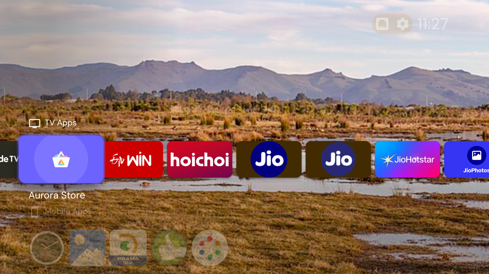
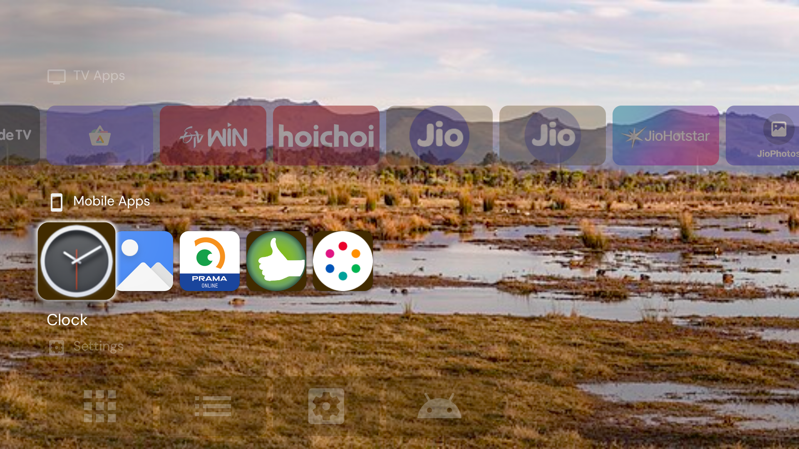
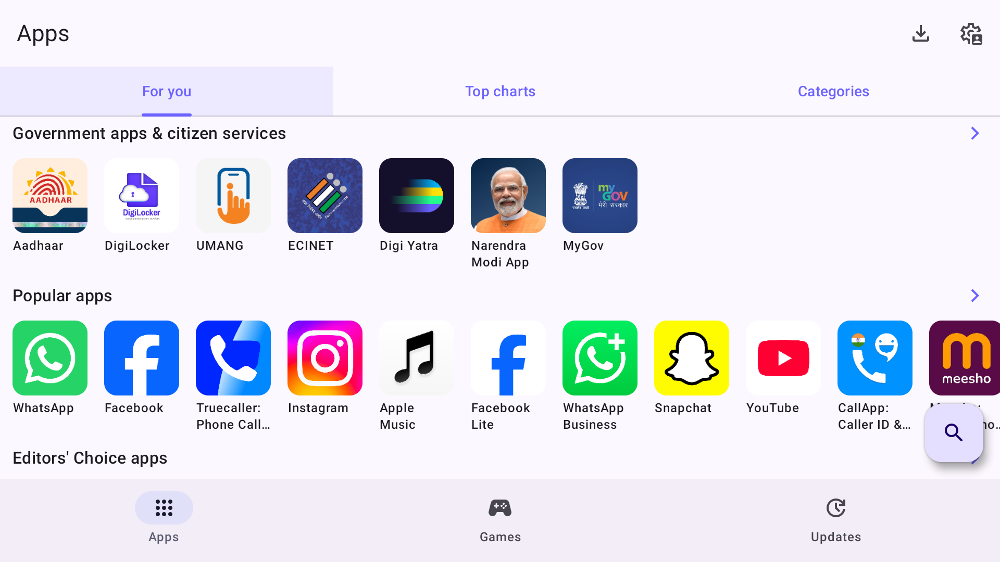

# 📺 Jio STB JMSB200Av2 — Complete Unlock & Customization Guide


This document provides a comprehensive, tested guide for transforming the **Reliance Jio Set-Top Box (Model JMSB200Av2)** running **Android 11** into an open, fully functional Android TV box.

---

## 📸 Visual Showcase

<p align="center">
  <b>Projectivy Home Launcher</b><br>
  
</p>

<p align="center">
  <b>Installed Apps & Custom Tools</b><br>
  
</p>

<p align="center">
  <b>Aurora Store (Google Play Store Client)</b><br>
  
</p>

---

## 🛠️ Hardware & Firmware Specifications

| Property | Details |
| :--- | :--- |
| **Model** | JMSB200Av2 |
| **Manufacturer** | Reliance Jio Infocomm Ltd / ODM Partner |
| **Processor (SoC)** | Amlogic Quad-Core (64-bit ARMv8-A) |
| **Android Version** | Android 11 (API level 30) |
| **Build Number** | `Jio/4KOTTSTB/MSTB:11/25.1.9/1:user/release-keys` |
| **RAM / Storage** | 2 GB RAM / 8 GB eMMC |
| **Connectivity** | 100M Ethernet, Dual-Band Wi-Fi (2.4/5 GHz), Bluetooth 5.0 |
| **Video Decoding** | 4K @ 60fps (AV1, VP9, H.265/HEVC, H.264) |
| **Audio Standards** | Dolby Atmos (Pass-through/Decode), DTS-HD, Stereo |

---

## 🚀 Step-by-Step Unlock Workflow

### 1. Enabling ADB Debugging via TR-069
The device runs a local CWMP/TR-069 client (`com.jio.tr069client`) listening on port `7547`.
1. Intercept or redirect TR-069 traffic to your local **GenieACS** server.
2. Push the following RPC parameter values to enable wireless ADB on port `5555`:
   - `Device.ManagementServer.EnableADB = true`
   - Alternatively, inject the ADB configuration command via ACS command execution parameters.
3. Once enabled, connect via ADB from your PC:
   ```bash
   adb connect <STB_IP_ADDRESS>:5555
   ```

---

### 2. Fixing the Remote "HOME" Button (Critical Fix)
By default, the STB has setup wizard flags disabled, causing the Android WindowManager to ignore the remote HOME key:
```bash
adb shell settings put secure tv_user_setup_complete 1
adb shell settings put secure user_setup_complete 1
adb shell settings put global device_provisioned 1
```

---

### 3. Deploying Ad-Free Launcher & App Stores

#### A. Projectivy Launcher
```bash
adb install -r projectivy_launcher.apk
```
* Grant Accessibility Service to override the stock launcher seamlessly:
  ```bash
  adb shell settings put secure enabled_accessibility_services com.spocky.projengmenu/com.spocky.projengmenu.services.AccessibilityService
  ```

#### B. Aurora Store (Direct Google Play Store Client)
Because this STB is an operator AOSP device without Google Play Protect certification, official Google Play Services crashes. **Aurora Store** connects directly to Google Play servers without needing GMS:
```bash
adb install -r aurora_store.apk
adb shell appops set com.aurora.store REQUEST_INSTALL_PACKAGES allow
adb shell appops set com.aurora.store MANAGE_EXTERNAL_STORAGE allow
```

#### C. Aptoide TV & SmartTube
* **Aptoide TV:** Android TV-optimized community store.
* **SmartTube:** YouTube with built-in SponsorBlock and ad-blocking.

---

### 4. Unlocking Cinematic Audio (Dolby Atmos & DTS-HD)
Force-enable hardware audio decoders and disable dynamic range compression:
```bash
# Enable Dolby Atmos / Surround Sound
adb shell settings put global encoded_surround_output 2

# Enable hardware surround format decoders
adb shell settings put global encoded_surround_output_enabled_formats "5,6,7,8,14,17,18"

# Disable Dynamic Range Compression (DRC) for clean, uncompressed audio
adb shell settings put global drc_mode 0
```

---

### 5. Accessing Stock Android TV Settings & Developer Options
The Jio Settings app (`com.rjil.jiostbsetting`) hijacks settings requests.
* **Launch Native Stock Settings:**
  ```bash
  adb shell am start -n com.android.tv.settings/.MainSettings
  ```
* **Launch Developer Options:**
  ```bash
  adb shell am start -n com.android.tv.settings/.development.DevelopmentSettingsActivity
  ```
* **Make Stock Settings Default:**
  ```bash
  adb shell pm uninstall -k --user 0 com.rjil.jiostbsetting
  ```

---

### 6. Debloating & Telemetry Removal

> [!CAUTION]
> **Important Note on JioTV+ SSO:**
> Do **NOT** uninstall `com.media.jio.sso.stb` if you intend to use JioTV+. Removing it will cause JioTV+ to crash on launch with an `ActivityNotFoundException (app://open.sso.app)`.

#### Safe Packages to Remove for User 0:
```bash
# Telemetry, Diagnostics & Ads
adb shell pm uninstall -k --user 0 com.jio.stbadservice
adb shell pm uninstall -k --user 0 com.jio.systemstats
adb shell pm uninstall -k --user 0 com.jio.stb.remotediagnose
adb shell pm uninstall -k --user 0 com.jio.appoptimizer

# Background Trackers & Schedulers
adb shell pm uninstall -k --user 0 com.jio.backgroundscheduler
adb shell pm uninstall -k --user 0 com.jio.bioscopecontentservice
adb shell pm uninstall -k --user 0 com.jio.stb.bot

# Operator Lock & Hotel Services
adb shell pm uninstall -k --user 0 com.jio.stb.hotellauncher
adb shell pm uninstall -k --user 0 com.jiostb.fti
```

---

### 7. Understanding JioTV+ Network Restrictions
JioTV+ (`com.jio.media.jiotvplus`) requires a Jio connection (JioFiber / AirFiber / Jio Hotspot).
* **Why?** Video manifests and Widevine DRM license requests are validated server-side by checking the client's public IP ASN (`AS55836 - Reliance Jio`). Requests originating from other ISPs (Asianet, Airtel, BSNL) are blocked by the CDN.
* **Workarounds:**
  1. Route STB traffic through a Jio 4G/5G mobile hotspot.
  2. Use standalone OTT apps (Hotstar, SonyLIV, Zee5, Prime Video) which work across all ISPs.
  3. Use universal IPTV players (e.g., [**JioFreeView-IPTV 500+ Free Live Channels Guide**](../../docs/free_live_tv_500_channels.md)).

---

## 📜 Credits & License
Developed as part of the **Jio STB Universal Modding Project**. Licensed under the [MIT License](../../LICENSE).
